# Bitácora — Adiviná la música

Registro de la evolución de la app, versión por versión: qué cambió, cómo se verificó, qué dificultades aparecieron y cómo se resolvieron.

- **App:** https://adivina-la-musica.vercel.app
- **Repositorio:** https://github.com/juampiAssi/adivina-la-musica

---

## Idea

Un juego diario estilo Wordle para fanáticos de las bandas sonoras: suena un fragmento de música y hay que adivinar de qué película, serie o videojuego es. Cuanto menos se escucha (3, 6 o 10 segundos), más puntos se ganan. Los aciertos se guardan en un estante personal y suman en un ranking.

**Público:** personas que consumen películas, series y videojuegos y disfrutan de su música; partidas cortas para jugar todos los días.

**Información que se guarda en Firebase:** los títulos de cada día, las jugadas de cada jugador (aciertos y fallos), el ranking (apodo y puntos, sin datos personales) y la fecha de inicio del calendario.

---

## Antes de V1: prototipos

### Prototipo 1 — juego con YouTube (25/10, commit `26df6d6`)

- Proyecto React + Vite, rutas y layout.
- Juego con fragmentos de 3, 6 y 10 s usando el reproductor embebido de YouTube.
- **Problema:** el reproductor muestra el título y la portada del video, y eso revela la respuesta.
- Se probó una capa borrosa encima del reproductor. Funcionaba visualmente, pero **las políticas de YouTube prohíben tapar u ocultar el reproductor**, así que se buscó otra solución.

### Prototipo 2 — audio con Deezer (25/10, commit `9d12ba5`)

- El audio pasó a salir de los **fragmentos de 30 s de la API de Deezer**, reproducidos con un `<audio>` propio: no se ve nada que revele la respuesta.
- YouTube quedó solo para la **revelación** al final, visible y sin tapar.
- Las preguntas salieron de una playlist propia de 300 temas: se buscaron en Deezer y quedaron 222 temas de 138 títulos (se descartaron los que no estaban o no tenían una película/serie/juego claro).
- Se agregaron: instrucciones al inicio, partidas sin repetir, pantalla final, autocompletado de respuestas (porque a veces se sabía la respuesta pero se escribía mal) y botón para saltear.

### Prototipo 3 — diseño "Vice" (26/10, commit `fca23f2`)

- Primera iteración de diseño, inspirada en la estética de atardecer de Miami del sitio de GTA VI (sin usar imágenes, logos ni tipografías de Rockstar).
- Paleta azul noche / violeta / rosa, tipografías Bebas Neue y Montserrat, palmeras propias en SVG, ecualizador animado, entradas "desde la oscuridad" y efectos atados al scroll, todo con CSS.
- **Por qué:** el juego es de música y cine; un clima de "noche de cine/neón" acompaña mejor que la interfaz genérica inicial. El diseño final se va a seguir iterando (V2/V3).

**Capturas** (`docs/capturas/`):

| Prototipo 1 — YouTube | Prototipo 2 — Deezer | Prototipo 3 — Vice |
|---|---|---|
| 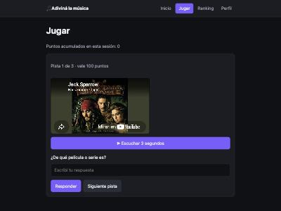 | 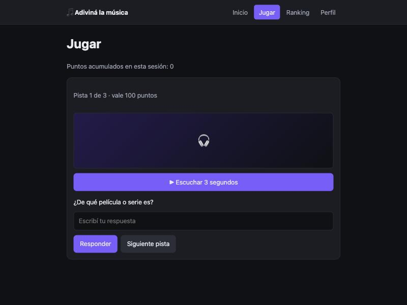 |  |
| El título del video revela la respuesta | Audio de Deezer sin pistas visuales | Primera iteración de diseño |
| 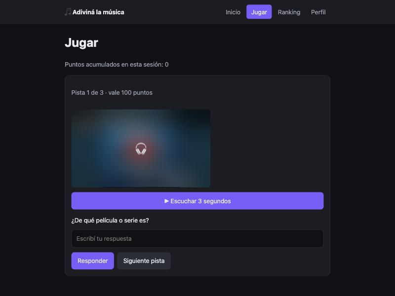 | 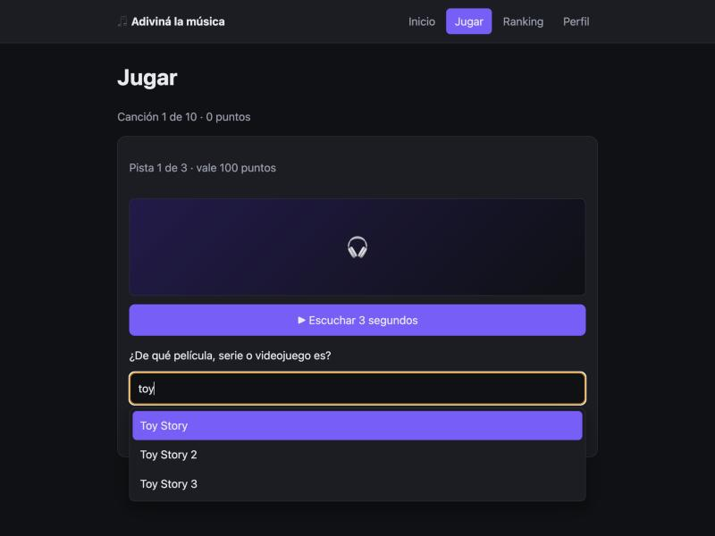 | 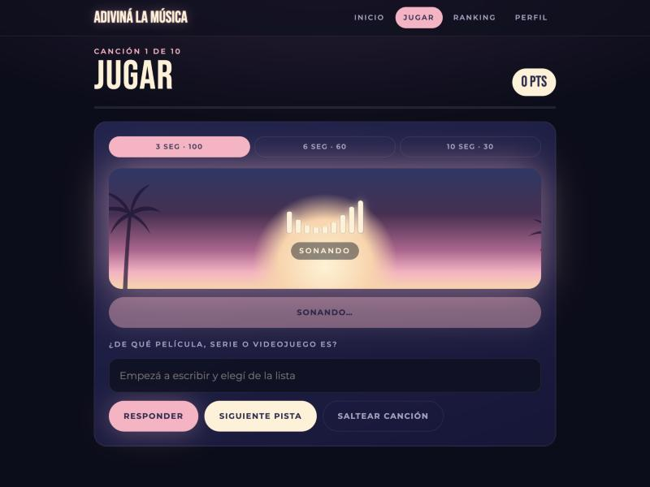 |
| Capa borrosa (descartada por las políticas de YouTube) | Autocompletado de respuestas | Recuadro de atardecer y ecualizador |

---

## V1 — Primera versión funcional publicada (27/10)

Commits: `277c637` (Firebase) y `80bb9ea` (Vercel).

### Qué se hizo

**Firebase**
- Proyecto `adivina-la-musica`, app web, Firestore Standard en `southamerica-east1` y Authentication (Anónimo + Correo/contraseña).
- `src/services/firebase.js`: único punto de conexión, con las variables `VITE_FIREBASE_*` leídas desde `import.meta.env`.
- **Sesión anónima automática** para jugadores. El administrador entra con **correo y contraseña de una cuenta genérica** (sin email real). Se decidió no usar Google para no guardar datos personales.
- Servicios para `config`, `titles`, `guesses` y `leaderboard`, con mensajes de error reales en la interfaz.

**Juego por día**
- 138 títulos repartidos en 14 días de 10 (el último de 8). Datos de año, dirección, género, sinopsis y póster obtenidos de TMDB con `scripts/build-titles.mjs`; los videojuegos se cargaron a mano.
- Cada día se desbloquea a las 00:00 de Argentina. Los días pasados se pueden jugar con la mitad de puntos ("ponte al día").
- Cada jugada (acierto o fallo) se guarda en `guesses/{uid}_{titleId}`, así no se puede jugar dos veces el mismo título.
- **Perfil:** apodo para el ranking (crear, editar, borrar) y estante con los aciertos (consultar, borrar).
- **Ranking:** top 20.

**Seguridad**
- `firestore.rules` comentadas: sin sesión no se lee nada, los títulos bloqueados no se pueden leer, las jugadas se validan contra el título real (puntos, atraso, hora del servidor) y cada jugador solo toca sus datos.
- Índice compuesto para la consulta "títulos del día".

**Panel admin** (`/admin`)
- Fecha de inicio del calendario (recalcula los desbloqueos de todos los títulos).
- Importador de JSON/CSV con vista previa, validación por fila y escritura en lotes de hasta 500, idempotente.

**Vercel**
- Proyecto conectado al repositorio de GitHub: cada push a `main` despliega solo.
- Variables `VITE_FIREBASE_*` como Config en Production y Preview; `vercel.json` con Vite, salida `dist` y rewrite para React Router.
- Dominio de Vercel agregado a los dominios autorizados de Firebase Authentication.

### Cómo se verificó

**Reglas de Firestore** (probadas contra el proyecto real con usuarios anónimos de prueba, que se borraron después):

| Prueba | Resultado esperado | Resultado |
|---|---|---|
| Leer sin sesión | Rechazado | ✔ |
| Escribir en `titles` o `config` sin ser admin | Rechazado | ✔ |
| Leer un título de un día bloqueado | Rechazado | ✔ |
| Crear una jugada con el uid de otro jugador | Rechazado | ✔ |
| Mandar puntos inventados, `cluesUsed` inválido o marcar "atrasada" una jugada de hoy | Rechazado | ✔ |
| Jugar dos veces el mismo título | Rechazado | ✔ |
| Leer o borrar la jugada de otro jugador | Rechazado | ✔ |
| Apodo de 2 caracteres o con caracteres no permitidos | Rechazado | ✔ |
| Escribir en una colección no prevista | Rechazado | ✔ |
| Jugada válida, apodo válido, borrar lo propio | Permitido | ✔ |

**CRUD en la app** (en local y en la URL de Vercel), comprobando cada cambio al recargar:

| Operación | Prueba | Local | Vercel |
|---|---|---|---|
| Consultar | El día 1 carga sus 10 canciones desde Firestore | ✔ | ✔ |
| Agregar | Adivinar una canción guarda la jugada (100 pts) | ✔ | ✔ |
| Recargar | La jugada sigue en el estante y la canción no se repite | ✔ | ✔ |
| Agregar | Elegir un apodo crea la entrada en el ranking | ✔ | ✔ |
| Modificar | Cambiar el apodo lo actualiza en el ranking | ✔ | ✔ |
| Eliminar | Borrar la jugada del estante descuenta los puntos | ✔ | ✔ |
| Eliminar | "Salir del ranking" borra la entrada | ✔ | ✔ |
| Errores | Formularios vacíos, apodo inválido, credenciales incorrectas y falta de índice muestran el error real | ✔ | — |
| Admin | Login, fecha de inicio e importación de 138 títulos | ✔ | ✔ (login) |

**Celular** (URL publicada, pantalla de 375 × 812): sin scroll horizontal; el audio suena, la lista de sugerencias se usa con el dedo, el acierto se guarda y el perfil, el estante y el ranking se ven bien. ✔

**"Ponte al día"** (URL publicada): con la fecha de inicio movida un día atrás desde el panel admin, el día 1 pasó a ser un día pasado. Las pistas mostraron 50 / 30 / 15, el acierto dio **"Ganaste 50 puntos"** y el estante lo marcó como **(atrasada)**. Además, contra las reglas: mandar una jugada atrasada como "a tiempo" o con 100 puntos se **rechaza**; con 50 puntos se acepta. ✔

**Actualización y despliegue:** cada push a `main` generó un despliegue nuevo en Vercel que terminó en estado *Ready*; los cambios (por ejemplo, el logo de TMDB) aparecieron en la URL publicada. Listado en `docs/evidencias/vercel-despliegues.txt`; la configuración de la base, en `docs/evidencias/firestore-base.txt`.

**Capturas de V1** (`docs/capturas/`):

| Compu | Celular | Celular |
|---|---|---|
| 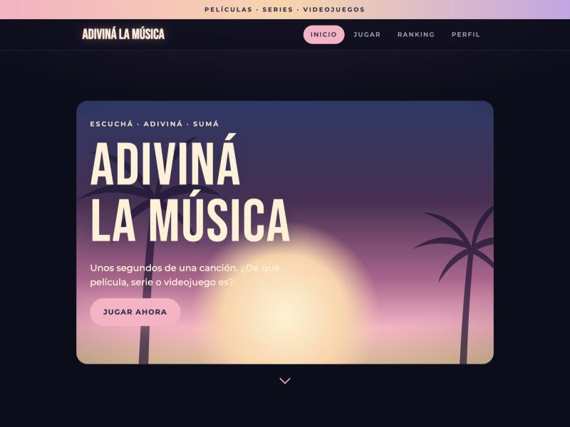 | 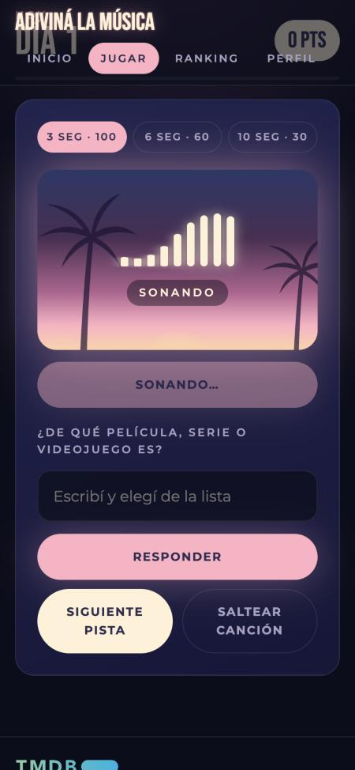 | 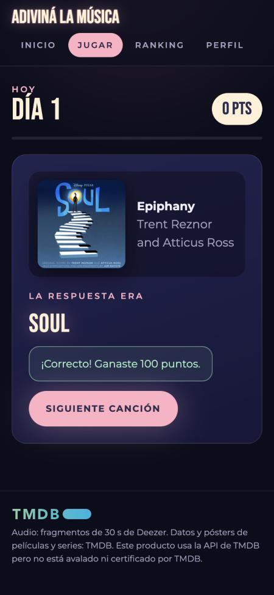 |
| Inicio | Fragmento sonando | Acierto con revelación |
| 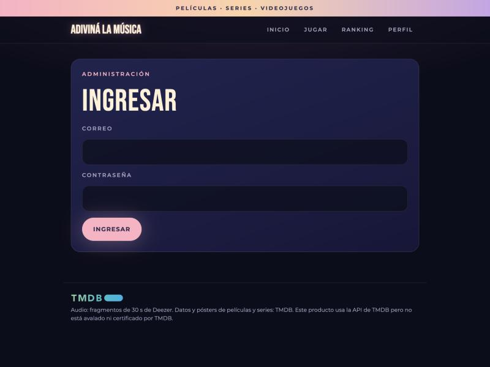 | 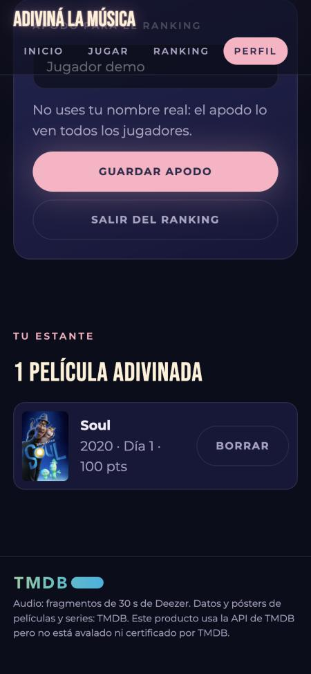 | 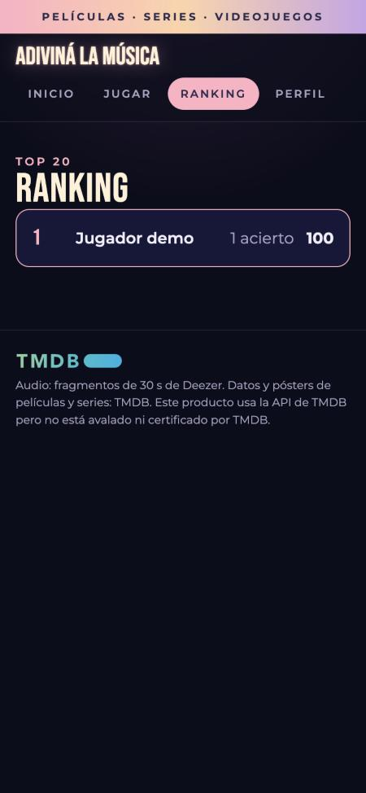 |
| Ingreso al panel admin | Estante | Ranking |
| 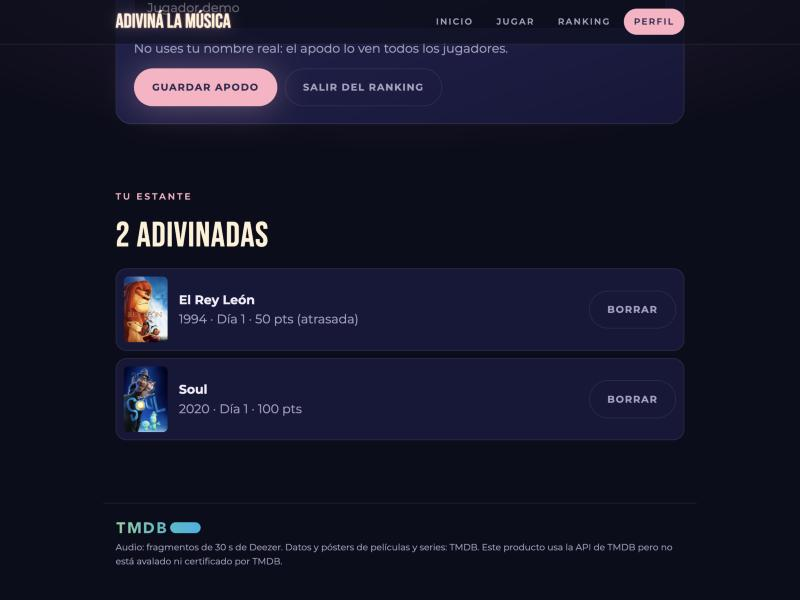 | 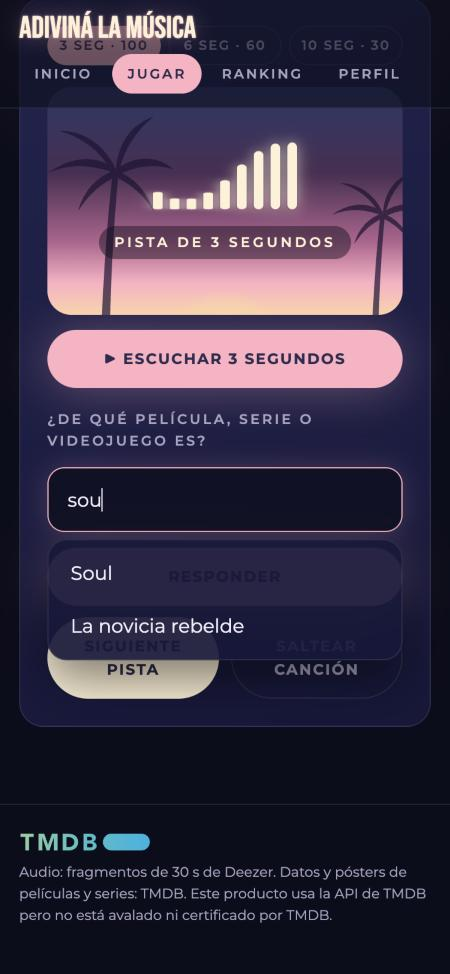 | 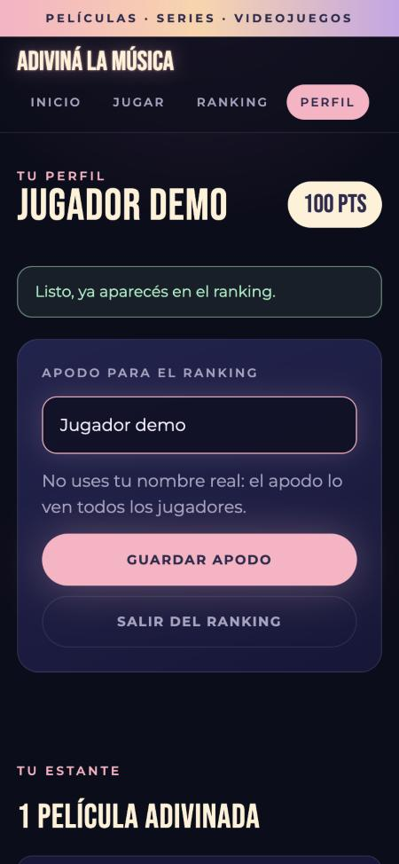 |
| Jugada atrasada (mitad de puntos) | Autocompletado | Apodo guardado |

### Dificultades y cómo se resolvieron

| Dificultad | Cómo se investigó | Solución |
|---|---|---|
| La CLI no pudo crear el proyecto: *"Callers must accept Terms of Service"* | Se leyó el log de depuración de `firebase-tools` | Aceptar los términos de Google Cloud en la consola y reintentar |
| Error 403 al agregar Firebase al proyecto de Google Cloud | Mismo log; reintento tras unos segundos | Crear el proyecto desde la consola de Firebase (aceptando sus términos) |
| No se podía crear Firestore desde la CLI: API desactivada | Mensaje de error de la CLI | Crear la base desde la consola, que activa la API |
| **La base quedó en "modo de prueba", abierta a cualquiera** | Una lectura sin sesión respondió 404 (permitido) en vez de 403 | Publicar las reglas antes de cargar cualquier dato |
| TMDB devolvió películas equivocadas (remake de 2025, una de Hitchcock con el mismo título en español, una película duplicada) | Revisión manual de los 138 resultados | Años de referencia y correcciones en el script |
| "Falta un índice" al abrir el juego | Error mostrado en pantalla y mensaje de Firestore | Publicar el índice compuesto y esperar a que se construya |
| Vercel detectó el proyecto como "Other" con salida `public` | `vercel project inspect` | Fijar Vite y `dist` en `vercel.json` |
| **La CLI de Vercel iba a subir `.env` y el token de TMDB** | Prueba en seco (`vercel deploy --dry`) | Agregar `.vercelignore` |
| Vercel agregó una regla `.env*` al `.gitignore` que anulaba la excepción de `.env.example` | Revisión del diff | Quitar esa regla |
| Vercel no podía conectar el repo privado | Mensajes de `vercel git connect` | Conectar GitHub al login de Vercel e instalar la app de Vercel solo para este repositorio |
| Las instrucciones de un día pasado mostraban los puntos completos | Prueba de "ponte al día" en la URL publicada | Pasarle a las instrucciones si el día es atrasado |
| Las capturas salían oscuras | Se revisaron los estilos de la página: estaban bien | La animación de entrada todavía no había terminado; se esperó antes de capturar |

### Decisiones sobre datos y terceros

- **Privacidad:** los jugadores son anónimos; no se guardan emails ni nombres. El apodo tiene el aviso "No uses tu nombre real".
- **YouTube:** no se tapa el reproductor (lo prohíben sus políticas); se usa solo para la revelación.
- **Deezer:** uso no comercial; sus términos no mencionan juegos. Se guarda solo el id del tema, nunca audio.
- **TMDB:** uso no comercial con atribución en el pie de página; sus datos no deben guardarse más de 6 meses.
- **Limitación conocida:** el total del ranking lo calcula el navegador y no se puede verificar sin backend (documentado en el README).

### Uso de IA

Herramienta: **Claude Code** (Claude, de Anthropic), dentro de la app de escritorio de Claude. Se usó para planificar, generar código, investigar términos de uso de APIs, interpretar errores y ejecutar comandos de las CLIs (`firebase-tools`, `vercel`, `gh`). Cada paso se revisó y probó antes de seguir; los pasos sobre cuentas (logins, términos, consola de Firebase, permisos de GitHub) los hice yo.

Ejemplos representativos de instrucciones dadas a la IA:

- *"Trabajá por pasos pequeños y frená después de cada uno para que yo pueda probar antes de seguir."*
- *"No quiero que se repitan las canciones; una vez que se terminen, que aparezca algo como 'muy bien, adivinaste todas las canciones del día'. Y al principio, un instructivo de cómo jugar."*
- *"Cuando escribe una letra, que aparezca un menú desplegable para poner bien el nombre, porque a veces lo puse mal aunque lo sabía."*
- *"Mirá la página de GTA VI, sus transiciones, movimientos y difuminados; me gustaría un diseño similar."*
- *"No quiero retener datos de usuarios ni mails; nada de cosas ilegales."* (de acá salió el login genérico para el admin)
- *"Nunca imprimas valores de claves. Antes de cada commit mostrame los archivos."*

También se agregó el **logo oficial de TMDB** en el pie de página, como piden sus términos.

### Pendientes para V2

- Rediseño a partir de bocetos propios en Figma (estante tipo VHS, pantalla de juego).
- Capturas de las consolas de Firebase y Vercel (requieren iniciar sesión).
- Revisar el título dudoso (*Cuenta conmigo*) y ajustar el segundo de inicio de los fragmentos poco reconocibles.
- Mostrar los puntos del día recién al guardar la jugada (hoy se actualizan al pasar a la siguiente canción).
